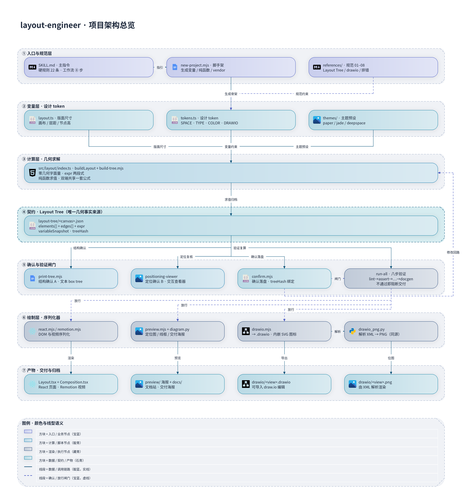
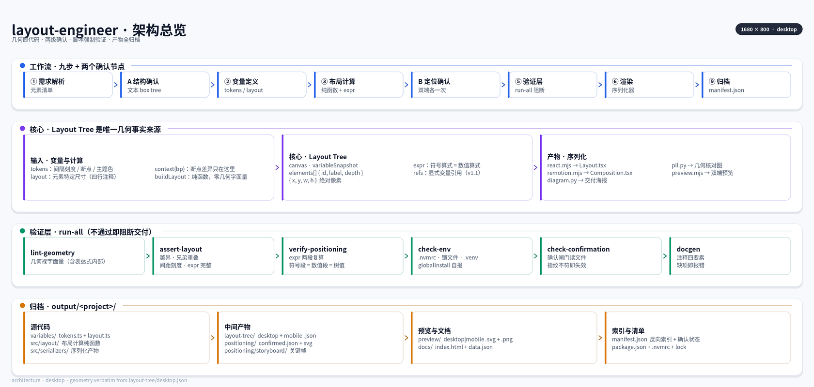

<h1 align="center">layout-engineer</h1>

<p align="center">
  
</p>

<p align="center"><b>让 AI 像工程师一样做布局</b> —— 几何即代码、两级确认、脚本强制验证、产物全量归档。</p>

<p align="center">
  <a href="https://github.com/[owner]/[repo]"></a>
  <a href="https://github.com/[owner]/[repo]/releases"></a>
  <a href="LICENSE"></a>
  <a href="https://github.com/[owner]/[repo]"></a>
  <a href="https://github.com/[owner]/[repo]/stargazers"></a>
  <a href="https://github.com/[owner]/[repo]/issues"></a>
  
  
  <a href="https://codecov.io/gh/[owner]/[repo]"></a>
</p>

<p align="center">
  <a href="#-这是什么">这是什么</a> ·
  <a href="#-功能特性">功能特性</a> ·
  <a href="#-工作原理">工作原理</a> ·
  <a href="#-安装指南">安装指南</a> ·
  <a href="#-快速上手">快速上手</a> ·
  <a href="#-配置说明">配置说明</a> ·
  <a href="#-api-文档">🔌 API 文档</a> ·
  <a href="#-示例与截图">示例</a>
</p>

---

## 📖 这是什么

`layout-engineer` 是一个 [Agent Skill](https://agentskills.io/specification)：把「页面长什么样」这件事从**凭感觉写数字**变成**用代码算几何**。

它只承认一个几何事实来源 —— **Layout Tree**：

```
variables/ ──→ layout/ ──→ layout-tree/ ──→ ┬─ positioning-viewer（确认）
 (tokens+layout)  (纯函数)    (双端 JSON)    ├─ serializers（渲染）
                               ↑             └─ indexer（反向索引）
                               └─ validate 八步：不通过即阻断
```

React 页面、Remotion 视频、位图预览、交付海报、**draw.io 架构图**，全都只是对同一棵树的不同「序列化」。

**三项结构性保证**：

| 保证 | 含义 |
|---|---|
| 🔗 **同源** | 图上标的 88px 与页面里的 88px 是同一个数字，不存在「图上是一套、代码是另一套」 |
| 🔧 **可修改** | 改几何只有一条合法路径：改变量 → 重算树 → 重出图；渲染器里没有几何计算 |
| ✅ **可验证** | 几何集中在一棵树里，越界 / 重叠 / 间距刻度 / 算式出处才能写成脚本，而不是靠人眼 |

> 💡 一句话总结：**布局只计算一次**，之后所有产物都从这棵树序列化出来。

---

## ✨ 功能特性

### 核心功能

- 🎯 **Layout Tree 唯一事实来源**：纯函数 `buildLayout(breakpoint)` 产出 `elements[]` + `edges[]` + `expr`，几何只算一遍。
- 🧮 **几何即代码**：布局计算里零几何字面量（连表达式内部都不许有），`lint-geometry` + ESLint 插件负责抓。
- 🔬 **算式出处（expr）**：每个节点的 `x/y/w/h` 都带两段式算式「符号算式 = 数值算式」，`verify-positioning` 分别复算。
- 📐 **双断点共享一套公式**：`desktop` / `mobile` 只是 `context()` 的入参不同，不允许写两套坐标。
- 🚦 **两级确认闸门**：结构确认（文本 box tree）→ 定位确认（交互式查看器双击确认），确认落盘并绑定 `treeHash`。
- 🛡️ **八步强制验证**：`run-all` 串行执行，任一步失败即中止，**不通过禁止渲染**。

### 高级功能

- 🎨 **设计 token 全覆盖**：`SPACE` / `COLOR` / `TYPE` / `RADIUS` / `SHADOW` / `GRADIENT` / `FONT` 全部进快照，换主题不动渲染代码。
- 🖼️ **draw.io 架构图同源**：`.drawio` 与 PNG 来自同一次序列化，`drawio_png.py` **解析 XML 再画**，图与文件严格一致。
- 🧩 **技术栈图标库**：内置框架 / 语言 / 平台图标（SVG + 配套位图 + `catalog.json`），节点用 `icon: string[]` 挂图标。
- 🛣️ **连线是几何数据**：锚点与途经点由布局纯函数算出并带 `expr`，`bandRouter()` / `channelRouter()` 保证平行连线可分辨。
- 🎬 **Storyboard → Remotion**：关键帧定位图先确认，再出视频分镜，视频走独立闸门。
- 🎭 **三种渲染风格**：`positioning`（几何核对）/ `diagram`（线框说明）/ `poster`（交付海报）。
- 📊 **成图前先量**：`measure.mjs` 把「图空不空、字读不读得清」量成数字，不达标先问用户。
- 🗂️ **反向索引 + 文档站**：`manifest.json` 三重结构（`variableSnapshot` / `variableUsage` / `confirmations`），`docgen` 自动出文档站。
- 🧰 **零运行时依赖**：只需 Node ≥ 22.6；`typescript`（AST 追溯）、`Pillow`（PNG）、draw.io Desktop（官方导出）都是可选增强。
- 🔒 **预览与交付物理隔离**：跳过确认的产物一律带 `PREVIEW-` 前缀（位图再加水印），无法冒充交付稿。

### 路线图

- [x] Layout Tree 契约 + 纯函数复算
- [x] 八步验证层 + 确认闸门（`treeHash` 绑定）
- [x] draw.io 架构图模式 + 通用绘图模式
- [x] 技术栈图标库与 `check-drawio` 自检
- [x] 主题预设（paper 宣纸墨 / jade 青瓷 / deepspace 深空）
- [ ] `refs` 显式引用成为变量归属主路径（消除 `(unknown)` 桶）
- [ ] 全局安装检测改为包装 `npm/pip` 审计（替代 `globalInstall` 自报）
- [ ] [待补充] 更多主题预设与图标素材

---

## 🏗️ 工作原理

下图是 **layout-engineer 用它自己生成的**项目架构总览 —— 所有盒子位置来自约束表达式，经
`lint-geometry / assert-layout / verify-positioning` 全量校验后渲染（源工程见
[`Bitmaps/overview.drawio`](Bitmaps/overview.drawio)）：



从上到下读这张图：

| 层 | 内容 | 关键脚本 |
|---|---|---|
| ① 入口与规范层 | 主指令、硬规则 22 条、脚手架、规范 01–08 | `SKILL.md` · `new-project.mjs` |
| ② 变量层 · 设计 token | 版面尺寸、`SPACE / TYPE / COLOR / DRAWIO`、主题预设 | `variables/layout.ts` · `tokens.ts` |
| ③ 计算层 · 几何求解 | `buildLayout`，零几何字面量、expr 两段式、纯函数 | `src/layout/index.ts` · `build-tree.mjs` |
| ④ 契约 · Layout Tree | `elements[]` + `edges[]` + `expr` + `variableSnapshot` + `treeHash` | `layout-tree/<canvas>.json` |
| ⑤ 确认与验证闸门 | 结构确认、定位确认、确认落盘、八步验证 | `print-tree` · `positioning-viewer` · `confirm` · `run-all` |
| ⑥ 绘制层 · 序列化器 | DOM/视频、几何图/海报、draw.io 与同源 PNG | `react.mjs` · `preview.mjs` · `drawio.mjs` · `drawio_png.py` |
| ⑦ 产物 · 交付与归档 | `Layout.tsx` / `Composition.tsx` / `preview/` / `drawio/*.drawio` + `*.png` | — |

### 工作流（两个确认节点不可跳过）

```
① 需求解析 → 元素清单 + 文本 box tree
      ↓ 【确认节点 A：结构确认】用户点头前不写布局代码
        （draw.io 架构图：还要问用户要哪几个视图 —— CLI / GUI / 硬件 / 软硬协同）
      ↓ 【参数确认】主题预设 / 配色 / 字号 / 是否要图例 / 密度目标 —— 先问，再写布局
② 变量定义   variables/tokens.ts + variables/layout.ts（四行注释）
③ 布局计算   context(breakpoint) + 唯一 layout(ctx) → 双端 Layout Tree
      ↓ 【确认节点 B：定位确认】查看器双端各确认一次
④ 修改回路   查 variableUsage → 结构化 diff 预览 → 用户确认 → 回到 ②
⑤ 验证层     lint / assert / verify / check-env / indexer / check-confirmation / check-drawio / docgen
⑥ 最终渲染   react / remotion / preview / drawio
      ↓ 【成图复审】先跑 measure.mjs，把占比 / 空白带 / 可读性数字给用户
⑦ 文档站     docgen     ⑧ 归档  完整目录 + manifest.json（含 confirmations）
```

> ⚠️ **确认状态必须落盘**（`positioning/confirmed.json`），渲染闸门**读文件不读对话** —— AI 绕不过去。
> `treeHash` 把确认绑定到当次布局：确认后再动树，确认自动失效。

---

## 📦 安装指南

### 前置要求

| 依赖 | 版本 / 说明 | 是否必需 |
|---|---|---|
| **Node.js** | `>= 22.6`（需要 TS type stripping） | ✅ 必需 |
| **Python 3** | 3.9+，用于位图通道（`preview` PNG / 海报 / draw.io PNG） | 可选 |
| **Pillow** | Python 图像库 | 有 Python 通道时必需 |
| **TypeScript** | `^5.9`，供 `indexer` 做 AST 反向索引 | 可选（缺失自动回退） |
| **draw.io Desktop** | 官方 CLI 导出 PNG/SVG/PDF（内嵌 XML） | 可选（缺失优雅降级） |
| **CJK 字体** | 例如 Noto Sans CJK SC | 渲染中文时必需 |

支持平台：**Windows / macOS / Linux**（Node 可跑即可；无原生扩展、无编译步骤）。

### 方式一：从源码克隆

```bash
git clone [GitHub 仓库地址待补充].git
cd layout-engineer

# 检查环境
node --version        # 需要 >= 22.6

# 安装开发依赖（只有 typescript；运行时不依赖任何包）
npm install
```

### 方式二：安装可选增强

```bash
# Python 位图通道
python3 -m venv .venv
source .venv/bin/activate        # Windows: .venv\Scripts\activate
pip install pillow

# 指定解释器（默认自动探测）
export LAYOUT_ENGINE_PYTHON=/path/to/python

# draw.io Desktop（可选，仅官方 CLI 导出需要）
# 安装与验证见 drawio/references/install-drawio.md
node drawio/scripts/serializers/drawio_cli.mjs --check
```

### 方式三：作为 Agent Skill 安装

```bash
# 将整个目录放进你的 Skill 目录，主指令为 SKILL.md
cp -r . ~/.your-agent/skills/layout-engineer
```

### 自检

```bash
node tests/run.mjs
```

---

## 🚀 快速上手

### 1. 跑一遍现成示例

```bash
cd layout-engineer

# 计算并归档双端 Layout Tree
node layout/scripts/build-tree.mjs --project examples/landing

# 强制验证（八步，不通过禁止渲染）
node layout/scripts/validate/run-all.mjs --project examples/landing

# 渲染全部产物
node drawio/scripts/serializers/index.mjs --project examples/landing --target all
```

预期输出（节选）：

```text
[build-tree] desktop  → layout-tree/desktop.json    (elements: 24, expr: 全部命中)
[build-tree] mobile   → layout-tree/mobile.json     (elements: 24, expr: 全部命中)
[build-tree] 纯函数性检查：两次计算一致 ✓

[run-all] 1/8 lint-geometry ...... ok
[run-all] 2/8 assert-layout ...... ok
[run-all] 3/8 verify-positioning . ok
[run-all] 4/8 check-env .......... ok
[run-all] 5/8 indexer ............ ok
[run-all] 6/8 check-confirmation . ok
[run-all] 7/8 check-drawio ....... skipped（非 drawio 项目）
[run-all] 8/8 docgen ............. ok

[serialize] react      → src/serializers/Layout.tsx
[serialize] remotion   → src/serializers/Composition.tsx
[serialize] preview    → preview/desktop.{svg,png}, preview/mobile.{svg,png}
[serialize] docgen     → docs/index.html
```

### 2. 新建一个项目

```bash
# 普通页面 / 布局（--list-themes 查看可用主题，--theme 选定视觉起点）
node scripts/new-project.mjs --name landing --out output/ --title "产品落地页" --theme jade

# draw.io 架构图（一个视图 = 一个项目；视图范围必须先问用户）
node scripts/new-project.mjs --name arch-hwsync --kind drawio --view hwsync --out output/arch --title "软硬协同架构"
```

### 3. 计算 → 确认 → 验证 → 渲染

```bash
P=output/landing

node layout/scripts/print-tree.mjs --project $P              # 结构确认（机器版）
node layout/scripts/build-tree.mjs --project $P              # 算出 Layout Tree
node layout/scripts/positioning-viewer/serve.mjs --project $P # 交互式定位确认

# 用户在对话里认可时落盘（AI 不得伪造确认）
node layout/scripts/confirm.mjs --project $P --node structure --source user-chat --note "用户回复：结构 OK"

node layout/scripts/validate/run-all.mjs --project $P        # 八步验证
node layout/scripts/measure.mjs --project $P                 # 成图前先量
node drawio/scripts/serializers/index.mjs --project $P --target all
```

### 4. 生成 draw.io 系统架构图

```bash
node drawio/scripts/serializers/index.mjs --project output/arch/arch-hwsync --target drawio
# → drawio/hwsync.drawio（可导入 draw.io 编辑，含内嵌 SVG 图标）
# → drawio/hwsync.png   （由 XML 解析渲染，与 .drawio 严格一致）

# 可选：官方 CLI 导出 PNG / SVG / PDF（内嵌 XML；无 draw.io Desktop 时自动跳过）
node drawio/scripts/serializers/drawio_cli.mjs --project output/arch/arch-hwsync --format png,svg,pdf
```

### 5. 生成通用 draw.io 图（流程图 / ER / 时序图）

```bash
# 通用绘图模式不进入 Layout Tree 与几何校验，规范见 references/08-drawio-freeform.md
node drawio/scripts/serializers/drawio_cli.mjs --project <dir> --format svg --embed-diagram
```

---

## ⚙️ 配置说明

### 项目配置文件 `layout.config.json`

```json
{ "kind": "drawio", "breakpoints": ["hwsync"] }
```

| 字段 | 默认值 | 说明 |
|---|---|---|
| `kind` | `"layout"` | 项目类型：`layout`（普通页面/布局）或 `drawio`（单画布架构图） |
| `breakpoints` | `["desktop", "mobile"]` | 需要构建的画布名；drawio 项目为**单画布**，刻意不产出空的 mobile 树 |

### 环境变量

| 变量 | 默认值 | 说明 |
|---|---|---|
| `LAYOUT_ENGINE_PYTHON` | 自动探测 | 指定 Python 解释器（位图 / 海报 / draw.io PNG 通道用） |

### 命令行参数（主要入口）

| 参数 | 默认值 | 说明 |
|---|---|---|
| `--project <dir>` | 无（必需） | 项目目录，所有脚本统一使用 |
| `--breakpoint <name>` | 全部 | 只处理指定断点，如 `desktop` |
| `--out <dir>` | `<project>/layout-tree` | Layout Tree 输出目录 |
| `--target <list>` | `all` | 序列化目标：`react,remotion,preview,drawio,drawio-cli` |
| `--style <name>` | `positioning` | 预览风格：`positioning` / `diagram` / `poster` |
| `--format <list>` | `png` | 官方 CLI 导出格式：`png,svg,pdf` |
| `--theme <name>` | 无 | 脚手架主题预设：`paper` / `jade` / `deepspace` |
| `--node <name>` | 无 | 确认节点：`structure` / `positioning` / `storyboard` |
| `--source <name>` | 无 | 确认来源：`viewer-ui` / `user-chat` / `fixture`（前两者才算人工确认） |
| `--host <addr>` | `0.0.0.0` | 定位查看器监听地址；`127.0.0.1` 仅本机 |
| `--port <n>` | `5173` | 定位查看器端口 |
| `--token <secret>` | 无 | 查看器 `/api/*` 访问令牌（**暴露公网务必设置**） |
| `--allow-unconfirmed` | 关闭 | 仅供 CI / 示例归档；产物一律加 `PREVIEW-` 前缀 |
| `--strict` | 关闭 | `measure.mjs` 有 fail 项时退出非 0 |

> ⚠️ 定位查看器**默认对外暴露端口**且可写文件（`/api/confirm` 会写 `positioning/`）。
> 在服务器上跑 skill、用本地浏览器打开时这很方便，但同网络内任何人都能读写该项目 —— 公网部署请加 `--token`。

---

## 🔌 API 文档

`layout-engineer` **既是 Skill 也是库**：核心模块都可以 `import` 出来当函数用（全部 ESM，零运行时依赖）。

### JavaScript / Node

```js
// 计算并归档双端 Layout Tree
import { buildTrees } from './layout/scripts/build-tree.mjs';
const trees = await buildTrees('./output/landing');

// 几何断言 / 连线断言
import { assertTree, assertEdges, assertEdgeOverlap, readSpacingScale }
  from './layout/scripts/validate/assert-layout.mjs';

// 算式两段复算
import { evaluate, splitExpr, verifyTree }
  from './layout/scripts/validate/verify-positioning.mjs';

// 反向索引与影响面预览
import { buildIndex, impactPreview, extractVariableDoc }
  from './layout/scripts/indexer.mjs';

// 同构 SVG 渲染器（查看器与导出共用）
import { renderSvg, flattenTree, numberMark, depthColor, DEPTH_COLORS }
  from './layout/scripts/positioning-viewer/render-core.mjs';
```

| 模块 | 导出 | 说明 |
|---|---|---|
| `build-tree.mjs` | `buildTrees(projectDir)` | 读 `src/layout/index.ts` 的 `buildLayout`，产出并归档双端树 |
| `assert-layout.mjs` | `assertTree` / `assertEdges` / `assertEdgeOverlap` / `readSpacingScale` | 越界 / 兄弟重叠 / 间距刻度 / expr 完整 / 连线几何 / 纯函数复算 |
| `verify-positioning.mjs` | `evaluate(expr, env)` / `splitExpr(expr)` / `verifyTree(tree, where)` | expr 符号段 = 数值段 = 树值（容差 0.02） |
| `indexer.mjs` | `buildIndex` / `impactPreview` / `extractVariableDoc` | `manifest.json` 三重结构 + 结构化 diff 预览 |
| `check-env.mjs` | `checkEnv(projectDir)` / `findGlobalInstalls(text, label)` | 环境隔离检查 |
| `docgen.mjs` | `parseDocComment` / `extractDeclarations` / `validateDeclarations` / `renderDocsHtml` | 注释四要素校验 + 文档站生成 |
| `render-core.mjs` | `renderSvg(tree, options)` / `flattenTree(elements)` / `numberMark(n)` / `depthColor(depth)` | 同构 SVG 渲染 |
| `lint-geometry` | `rules`（ESLint 插件规则 `no-geometry-literals`） / `lintSource` / `tokenize` | 几何裸字面量检查 |
| `storyboard/index.mjs` | `computeKeyframeTimes` / `hiddenAt` / `intervalAt` / `renderKeyframes` / `toRemotionTimeline` / `renderTimelineSvg` | 关键帧与时间轴 |
| `layout-engine/hash.mjs` | `hashLayoutTree(tree)` / `HASH_VERSION` | 只对几何载荷取指纹，绑定确认 |

**最小可运行示例**：

```js
import { evaluate, splitExpr } from './layout/scripts/validate/verify-positioning.mjs';

const env = { SPACE_LG: 24, HEADER_H: 64 };
evaluate('HEADER_H + SPACE_LG', env);        // → 88
splitExpr('HEADER_H + SPACE_LG = 64 + 24');  // → ["HEADER_H + SPACE_LG", " 64 + 24"]
```

```js
import { readFileSync } from 'node:fs';
import { renderSvg } from './layout/scripts/positioning-viewer/render-core.mjs';

const tree = JSON.parse(readFileSync('./output/landing/layout-tree/desktop.json', 'utf8'));
const svg = renderSvg(tree, { showDistances: true, showExpr: true });
```

### Python

```python
# 位图通道：几何核对图 / 交付海报 / draw.io → PNG
# python3 drawio/scripts/serializers/pil.py       --tree <json> --out <png> [--scale 2] [--centers]
# python3 drawio/scripts/serializers/diagram.py   --tree <json> --out <png> [--footer "..."]
# python3 drawio/scripts/serializers/drawio_png.py --drawio <file>.drawio --out <png> [--scale 2]
```

| 脚本 | 用途 | 特点 |
|---|---|---|
| `pil.py` | 几何核对图 | 坐标零运算；`--scale` 是整图重采样 |
| `diagram.py` | 交付海报 | 圆角卡片 / 区块配色 / 字阶 / 连接符 / 真高斯柔影 |
| `drawio_png.py` | `.drawio` → PNG | **解析 XML 再画**，所以「图与 XML 一致」是结构保证 |

> `_visual.py` 是两条 Python 通道共享的视觉 primitives（线性渐变 / 高斯柔影 / 圆角蒙版 / 字体族回退链），
> 保证「同一个 token 只有一种画法」；`_gate.py` 让 Python 序列化器也走同一份确认闸门判定。

### 定位查看器 HTTP 接口

| 方法 | 路径 | 说明 |
|---|---|---|
| `GET` | `/` | 查看器页面（静态资源不受 token 限制） |
| `GET` | `/api/trees` | `{ project, projectName, trees: {desktop, mobile} }` |
| `GET` | `/api/refresh` | 重新读取 `layout-tree/*.json` |
| `POST` | `/api/export` | body `{breakpoint, options}` → `{svg}` |
| `POST` | `/api/confirm` | body `{options, source}` → 写 `confirmed-*.svg` / `confirmed.json` / `viewer.html` |

设置 `--token` 后，所有 `/api/*` 需带 `?token=<secret>` 或请求头 `x-viewer-token`，否则返回 401。

---

## 🖼️ 示例与截图

### 项目架构总览（由 layout-engineer 自身生成）


> 📌 上方这张图的**每一个盒子位置**都来自约束表达式，源工程是
> [`Bitmaps/overview.drawio`](Bitmaps/overview.drawio) ——
> 可以直接导入 draw.io 编辑，也可以复算校验。

### 交付海报（同一棵树，不同渲染风格）



> 🎯 同一份 `layout-tree/desktop.json`，换 `--style` 就得到核对图 / 线框图 / 交付海报，
> 几何数字一个都不变。源工程见 [`examples/architecture/`](examples/architecture)。

### 复现命令

```bash
cd examples/architecture
node ../../layout/scripts/build-tree.mjs --project .          # 约束表达式 → Layout Tree
node ../../layout/scripts/validate/run-all.mjs --project .    # 全量校验（不通过禁止渲染）
node ../../drawio/scripts/serializers/preview.mjs --project . --style poster   # 交付海报
```

### 运行后产物长什么样

```text
output/landing/
├── layout-tree/{desktop,mobile}.json            双端布局中间表示（含 variableSnapshot）
├── positioning/confirmed-{desktop,mobile}.svg   用户确认时的定位图
├── positioning/confirmed.json                   确认记录（含 treeHash）
├── positioning/viewer.html                      查看器快照
├── positioning/storyboard/kf-*.svg              视频关键帧定位图
├── positioning/storyboard/timeline.svg          时间轴轨道图
├── preview/{desktop,mobile}.{svg,png}           双端预览图
├── drawio/<view>.drawio + <view>.png            draw.io 架构图（可编辑 + 同源 PNG）
├── docs/index.html                              自动生成的文档站
├── manifest.json                                变量反向索引（三重结构）
└── src/serializers/{Layout,Composition}.tsx     React / Remotion 序列化产物
```

---

## 🧪 测试与质量

```bash
cd layout-engineer

node tests/run.mjs                                   # 单元 + 集成测试
node layout/scripts/validate/run-all.mjs --project examples/landing   # 八步强制验证
node layout/scripts/measure.mjs --project examples/landing --strict   # 成图密度闸门
node drawio/scripts/icons/build-catalog.mjs --check  # 图标目录一致性
```

| 检查 | 命令 | 覆盖内容 |
|---|---|---|
| 构建状态 | [CI 徽章地址待补充] | GitHub Actions（`[workflow 名称待补充]`） |
| 代码覆盖率 | [Codecov 地址待补充] | [待补充] |
| 几何规范 | `lint-geometry` | 几何裸字面量（含表达式内部） |
| 几何断言 | `assert-layout` | 越界 / 兄弟重叠 / 间距刻度 / expr 完整 / 连线不穿节点 / 连线不共线重合 / 纯函数复算 |
| 算式一致性 | `verify-positioning` | 符号段 = 数值段 = 树值 |
| 环境隔离 | `check-env` | `.nvmrc` / 锁文件 / `node_modules` / `.venv` |
| 确认闸门 | `check-confirmation` | 结构 + 定位（或 storyboard）确认，指纹绑定 |
| 架构图自检 | `check-drawio` | XML 可解析 / 几何与树一致 / 文字不截断 / 图例与边距 / 图标不侵入文字 |
| 文档完整性 | `docgen` | 函数四要素注释，缺项即失败 |

### 验收 Checklist

**机器判定**（任一非 0 即整体失败）：

- [x] `lint-geometry` 退出码 0
- [x] `assert-layout` 退出码 0
- [x] `verify-positioning` 退出码 0
- [x] `check-env` 退出码 0
- [x] `indexer` 退出码 0（manifest 三重结构）
- [x] `check-confirmation` 退出码 0
- [x] `check-drawio` 退出码 0（交付 draw.io 架构图时）
- [x] `build-catalog.mjs --check` 退出码 0（使用技术栈图标时）
- [x] `measure.mjs` 无 fail 项
- [x] `docgen` 退出码 0

**人工判定**（机器无法代替用户判断的部分）：

- [ ] 结构 box tree 已获用户确认（drawio 还需确认**要哪几个视图**）
- [ ] 双端定位图（或关键帧 storyboard）已获用户确认
- [ ] draw.io 的 PNG 已亲眼核对（文字 / 连线 / 层 / 图例 / 边距）
- [ ] 参数确认（配色 / 字号 / 图例 / 密度目标）与 `measure.mjs` 数字已确认

---

## 🗂️ 项目结构

```text
layout-engineer/
├── SKILL.md                    主指令：两层结构 + 硬规则 22 条 + 工作流 + 禁止事项
├── scripts/new-project.mjs     跨层脚手架入口（--kind layout|drawio）
├── references/04-scripts.md    跨层脚本索引
│
├── layout/                     ← 计算层：算几何、验证、确认。唯一产出 Layout Tree
│   ├── scripts/layout-engine/     Layout Tree 类型 + builder + schema + IO + AST + 指纹 + 确认存储
│   ├── scripts/positioning-viewer/ 交互式定位查看器（同构 SVG 渲染器）
│   ├── scripts/validate/          lint-geometry / assert-layout / verify-positioning / check-env
│   │                              / check-confirmation（闸门）/ run-all（八步总入口）
│   ├── scripts/                   build-tree / indexer / confirm / print-tree / docgen / measure
│   ├── templates/                 tokens + layout 样板、项目骨架、主题预设
│   └── references/                01 规范 / 02 Layout Tree / 03 工作流 / 05 Storyboard / 06 排错
│
├── drawio/                     ← 绘制层：把 Layout Tree（以及通用绘图）画成 draw.io 与其它产物
│   ├── scripts/serializers/       drawio.mjs + drawio_png.py + drawio_cli.mjs
│   │                              react / remotion / preview / diagram.py / pil.py / index / gate
│   ├── scripts/validate/          check-drawio.mjs（架构图自检）
│   ├── scripts/icons/             build-catalog.mjs → catalog.json
│   ├── scripts/storyboard/        关键帧 + 时间轴轨道
│   ├── scripts/xml.mjs            XML 序列化 / 独立严格解析器
│   ├── assets/icons/              技术栈图标素材库（SVG + 配套位图）+ catalog.json
│   ├── templates/drawio/          drawio 项目骨架
│   └── references/                07 架构图 / 08 通用绘图 / install-drawio
│
├── examples/landing/           可跑通的双端示例（含 storyboard）
├── examples/architecture/      用本 Skill 生成的自身架构图（海报）
├── examples/drawio-hwsync/     draw.io 软硬协同架构图（6 层 / 20 节点 / 15 连线）
└── tests/run.mjs               单元 + 集成测试
```

**两层契约**：`layout-tree/<canvas>.json`（含 `elements[]` + `edges[]` + `expr`）。
计算层产出，绘制层只读；依赖方向单向 `drawio/ → layout/`。

---

## ❓ 常见问题

<details>
<summary><b>为什么不能直接在渲染代码里改一个坐标？</b></summary>

因为渲染器里**没有几何计算**，所有 `x/y/w/h` 都是从树里原样映射的。改坐标只有一条合法路径：
改变量 → `build-tree` 重算 → 重新确认 → 重出图。这样「改了哪里、为什么改」永远可追溯。
</details>

<details>
<summary><b>确认之后我发现树算错了怎么办？</b></summary>

直接改。`treeHash` 只覆盖几何载荷，树一变旧确认自动失效，渲染闸门会拦住你并提示重新确认 ——
这是 fail-closed 设计，不会让你误交一张基于旧布局的图。
</details>

<details>
<summary><b>没有装 Pillow / draw.io Desktop 会怎样？</b></summary>

不会失败。位图通道缺失时自动跳过并提示安装方式；draw.io Desktop 缺失时 `drawio-cli` 导出优雅降级
（退出码 0），需要强制失败时加 `--require`。`drawio.mjs` 自带的 PNG 通道只依赖 Pillow。
</details>

<details>
<summary><b>系统没有 CJK 字体会怎样？</b></summary>

`drawio_png.py` 会**拒绝渲染** —— 宁可不交图，也不交一张全是豆腐块（□□□）的图。
安装 Noto Sans CJK 或同类字体即可。
</details>

<details>
<summary><b>为什么图例是可选的？</b></summary>

默认在成图前问用户要不要；要则只列图里**真的出现过**的类别，线型用线段样例而不是色块。
</details>

---

## 🤝 贡献指南

欢迎任何形式的贡献：报告 Bug、提出新场景、改进验证规则、补充图标素材。

1. **先搜再提** —— 在 [Issues](https://github.com/[owner]/[repo]/issues) 里搜一下有没有同样的问题。
2. **报告问题** —— 尽量附上：复现命令、`--project` 目录结构、`layout-tree` 片段、完整错误输出、Node 版本。
3. **提交 PR**
   ```bash
   git checkout -b feat/your-feature
   # 改完务必跑一遍
   node tests/run.mjs
   node layout/scripts/validate/run-all.mjs --project examples/landing
   git commit -m "feat: 一句话说明改了什么"
   git push origin feat/your-feature
   ```
4. **遵守硬规则** —— 新增代码不得在布局计算里写几何字面量、不得在序列化器里做几何运算、
   不得绕开确认闸门。规范细则见 [`layout/references/01-standards.md`](layout/references/01-standards.md)。

> 💡 提交任何**新的几何能力**时，请同时补上对应的验证规则与测试 —— 「机器能判定」是这个项目的底线。

详细约定见 [CONTRIBUTING.md](CONTRIBUTING.md)。

---

## 📄 许可证

本项目采用 **MIT License**，详见 [LICENSE](LICENSE)。

> ⚠️ **注意**：`drawio/` 目录下通用绘图部分的版权声明**独立于 MIT**，
> 著作权归 江一帆（Jiang Yifan）所有，见
> [`drawio/LICENSE-DRAWIO.md`](drawio/LICENSE-DRAWIO.md)。
> 使用该部分前请先阅读其条款。

---

## 🙏 致谢

- **作者 / 维护者**：江一帆（Jiang Yifan）
- **项目缘起**：受够了「AI 凭感觉给尺寸」的返工 —— 于是把几何变成代码，把确认变成闸门，把验证变成脚本。
- **第三方项目与素材**：
  - [draw.io / diagrams.net](https://github.com/jgraph/drawio) —— `.drawio` 格式与官方导出 CLI
  - [Remotion](https://github.com/remotion-dev/remotion) —— 视频分镜的序列化目标
  - [React](https://github.com/facebook/react) —— DOM 序列化目标
  - [TypeScript](https://github.com/microsoft/TypeScript) —— AST 反向索引（可选依赖）
  - [Pillow](https://github.com/python-pillow/Pillow) —— 位图渲染通道
  - [Shields.io](https://shields.io) —— README 徽章
- 以及所有把「布局是不可验证的」当成常识、却依然在尝试让它可验证的人。

---

<h3 align="center">如果这个项目对你有帮助，请给一个 ⭐️</h3>

<p align="center">
  <i>几何即代码 · 确认即闸门 · 验证即脚本 · 产物即档案</i>
</p>
